# EEDF - Intelligent Document Processing

A Python application that leverages Google Gemini LLM to extract structured data from legal contracts and documents (PDF/DOCX). Built with FastAPI, LangGraph, and SQLite.

## Features

- **AI-Powered Extraction**: Uses Google Gemini to extract parties, terms, dates, obligations, and clauses
- **Multi-Format Support**: Processes PDF and DOCX documents
- **Agentic Workflow**: LangGraph orchestrates the extraction pipeline
- **Web Interface**: Clean single-page UI for document management
- **SQL Explorer**: Query extracted data directly with SQL
- **Async Processing**: Non-blocking document processing with real-time status updates

---

## Table of Contents

- [System Architecture](#system-architecture)
- [Installation](#installation)
  - [Using UV (Recommended)](#using-uv-recommended)
  - [Using Python venv](#using-python-venv)
- [Configuration](#configuration)
- [Running the Application](#running-the-application)
- [How It Works](#how-it-works)
- [API Reference](#api-reference)
- [Database Schema](#database-schema)
- [Project Structure](#project-structure)

---

## System Architecture

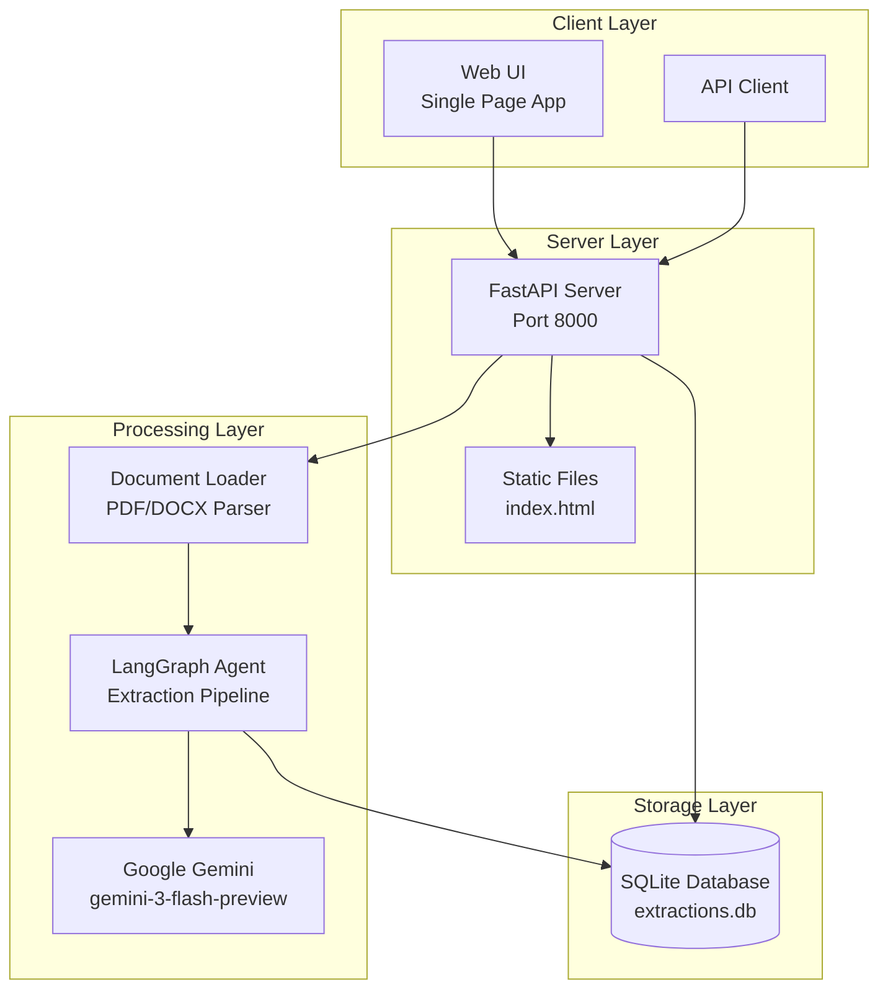

---

## Installation

### Prerequisites

- Python 3.11 or higher
- Google API Key for Gemini

### Using UV (Recommended)

[UV](https://github.com/astral-sh/uv) is a fast Python package manager written in Rust.

#### Install UV

```bash
# macOS/Linux
curl -LsSf https://astral.sh/uv/install.sh | sh

# Windows (PowerShell)
powershell -ExecutionPolicy ByPass -c "irm https://astral.sh/uv/install.ps1 | iex"

# Or via pip
pip install uv
```

#### Create Virtual Environment

```bash
# Create and sync dependencies
uv sync
```

#### Activate Virtual Environment

**macOS/Linux:**
```bash
source .venv/bin/activate
```

**Windows (Command Prompt):**
```cmd
.venv\Scripts\activate.bat
```

**Windows (PowerShell):**
```powershell
.venv\Scripts\Activate.ps1
```

---

### Using Python venv

#### Create Virtual Environment

**macOS/Linux:**
```bash
python3 -m venv .venv
```

**Windows:**
```cmd
python -m venv .venv
```

#### Activate Virtual Environment

**macOS/Linux:**
```bash
source .venv/bin/activate
```

**Windows (Command Prompt):**
```cmd
.venv\Scripts\activate.bat
```

**Windows (PowerShell):**
```powershell
.venv\Scripts\Activate.ps1
```

> **Note:** If you get an execution policy error on PowerShell, run:
> ```powershell
> Set-ExecutionPolicy -ExecutionPolicy RemoteSigned -Scope CurrentUser
> ```

#### Install Dependencies

```bash
pip install -e .
```

Or install from requirements:

```bash
pip install fastapi uvicorn python-multipart pypdf python-docx google-genai langchain langgraph aiosqlite pydantic reportlab
```

---

## Configuration

### Environment Variables

Create a `.env` file in the project root or export the variable:

**macOS/Linux:**
```bash
export GOOGLE_API_KEY=your_gemini_api_key
```

**Windows (Command Prompt):**
```cmd
set GOOGLE_API_KEY=your_gemini_api_key
```

**Windows (PowerShell):**
```powershell
$env:GOOGLE_API_KEY="your_gemini_api_key"
```

### Configuration Parameters

| Parameter | Default | Description |
|-----------|---------|-------------|
| `GOOGLE_API_KEY` | Required | Google Gemini API key |
| `LLM_MODEL` | `gemini-3-flash-preview` | Gemini model to use |
| `MAX_CHUNK_SIZE` | 8000 | Maximum characters per chunk |
| `CHUNK_OVERLAP` | 500 | Overlap between chunks |

---

## Running the Application

### Generate Test Documents (Optional)

Generate synthetic legal contracts for testing:

```bash
# Using UV
uv run python -m eedf.generate_test_docs

# Using venv
python -m eedf.generate_test_docs
```

This creates 6 test documents in `test_documents/`:
- 3 PDFs: Service Agreement, NDA, Commercial Lease
- 3 DOCX: Employment Contract, Partnership Agreement, Consulting Agreement

### Start the Server

```bash
# Using UV
uv run uvicorn eedf.main:app --reload

# Using venv
uvicorn eedf.main:app --reload
```

Open your browser at **http://localhost:8000**

---

## How It Works

### Document Upload Flow

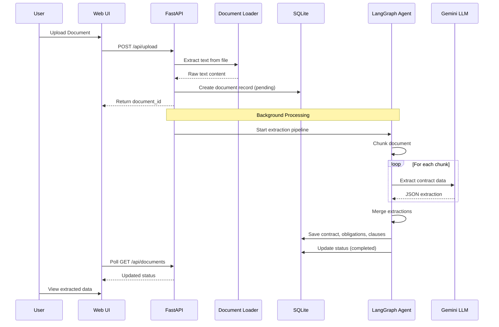

### LangGraph Extraction Pipeline

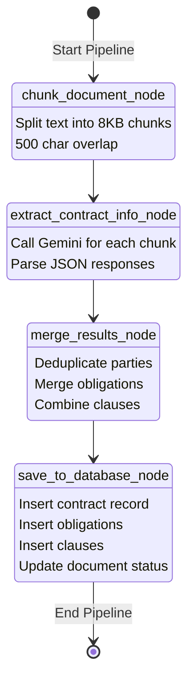

### Agent State Flow

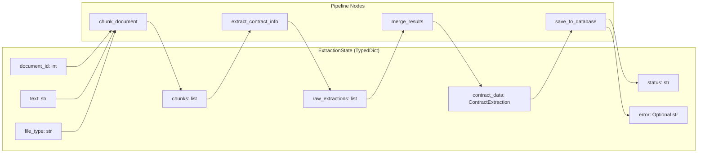

### Document Processing Pipeline

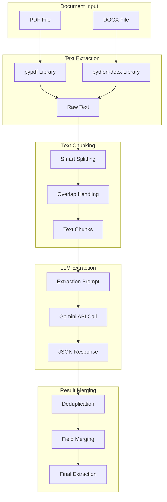

### Extraction Data Model

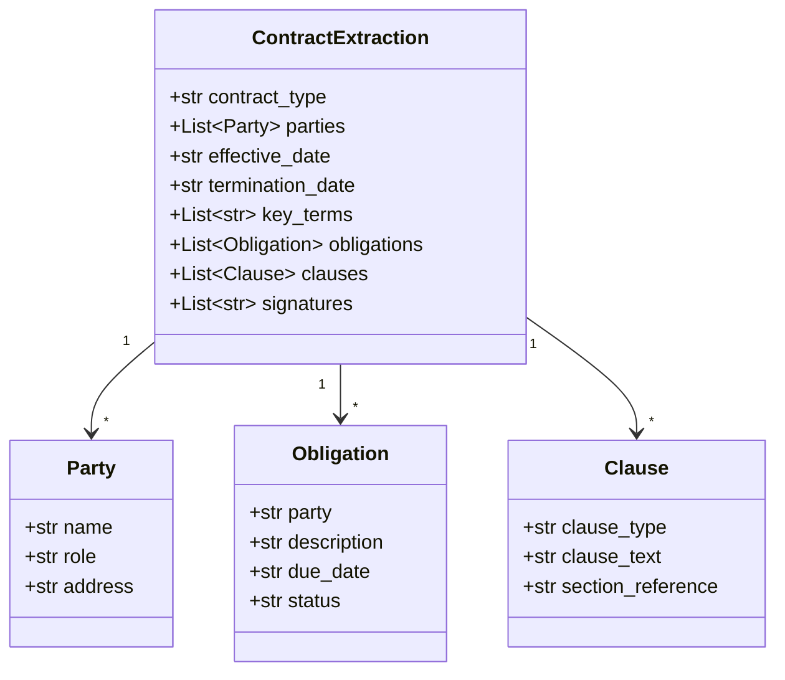

---

## API Reference

### Endpoints Overview

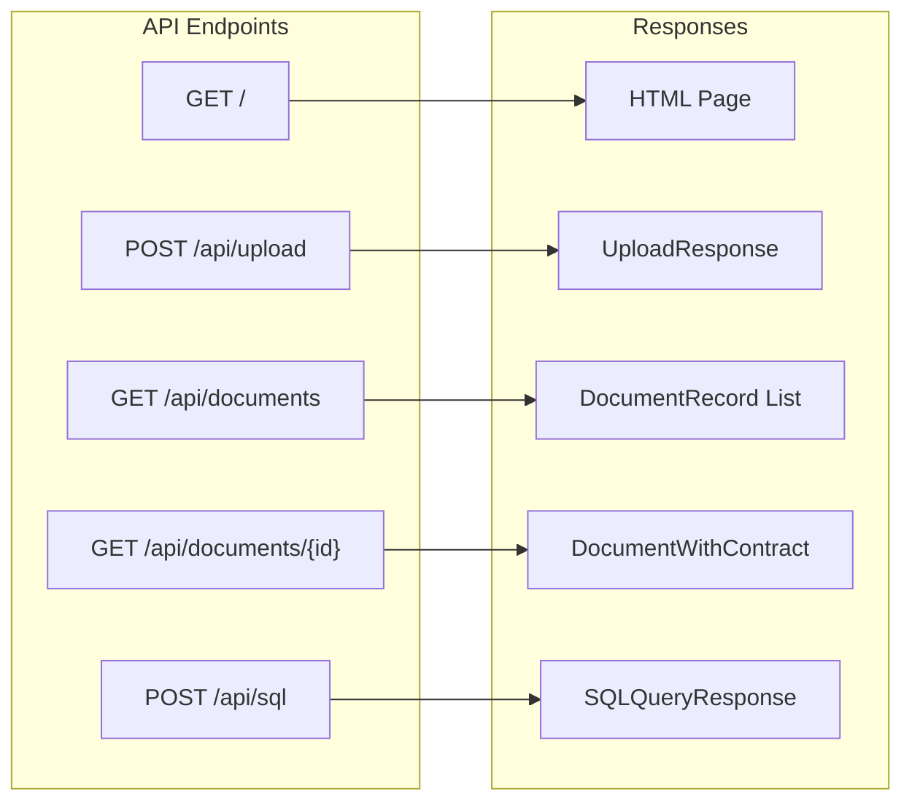

### Endpoint Details

| Endpoint | Method | Description | Request | Response |
|----------|--------|-------------|---------|----------|
| `/` | GET | Serve web UI | - | HTML |
| `/api/upload` | POST | Upload document | `multipart/form-data` | `{document_id, filename, status, message}` |
| `/api/documents` | GET | List all documents | - | `{documents: DocumentRecord[]}` |
| `/api/documents/{id}` | GET | Get document details | Path: `id` | `DocumentWithContract` |
| `/api/sql` | POST | Execute SQL query | `{query: string}` | `{columns, rows, row_count}` |

### Upload Response

```json
{
  "document_id": 1,
  "filename": "contract.pdf",
  "status": "processing",
  "message": "Document uploaded and processing started"
}
```

### Document Status Values

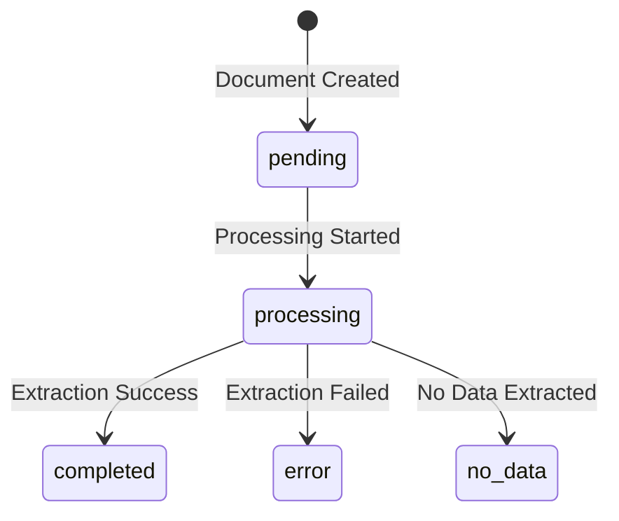

---

## Database Schema

### Entity Relationship Diagram

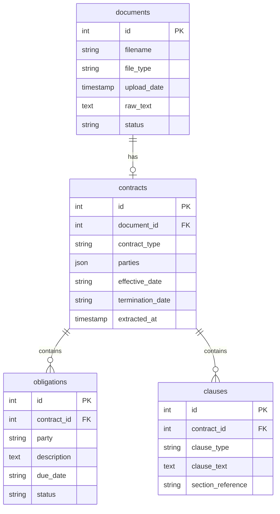

### Table Descriptions

| Table | Purpose | Key Fields |
|-------|---------|------------|
| `documents` | Uploaded files and raw text | filename, status, raw_text |
| `contracts` | Extracted contract metadata | contract_type, parties (JSON), dates |
| `obligations` | Party obligations | party, description, due_date |
| `clauses` | Legal clauses | clause_type, clause_text |

### Sample SQL Queries

```sql
-- Get all completed documents with contract types
SELECT d.filename, c.contract_type, c.effective_date
FROM documents d
JOIN contracts c ON d.id = c.document_id
WHERE d.status = 'completed';

-- Get all obligations grouped by party
SELECT party, COUNT(*) as obligation_count
FROM obligations
GROUP BY party;

-- Get clauses by type
SELECT clause_type, COUNT(*) as count
FROM clauses
GROUP BY clause_type
ORDER BY count DESC;
```

---

## Project Structure

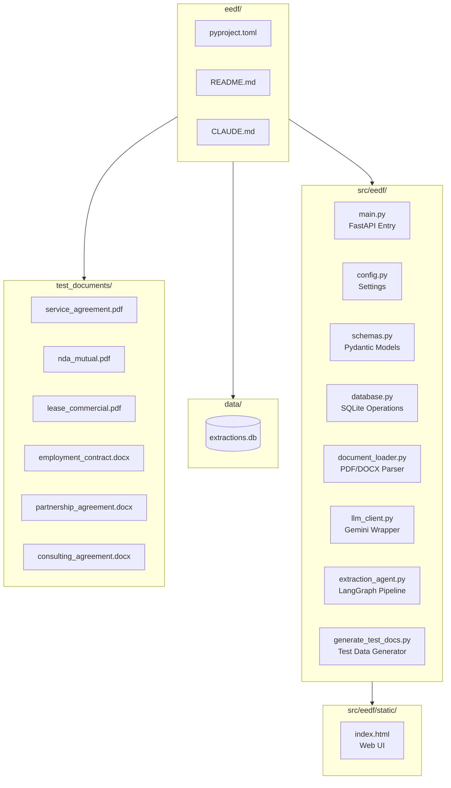

### File Descriptions

| File | Purpose |
|------|---------|
| `main.py` | FastAPI application, routes, and startup logic |
| `config.py` | Environment variables and configuration constants |
| `schemas.py` | Pydantic models for request/response validation |
| `database.py` | SQLite schema, async operations, CRUD functions |
| `document_loader.py` | PDF/DOCX text extraction and chunking |
| `llm_client.py` | Google Gemini API integration and prompt engineering |
| `extraction_agent.py` | LangGraph workflow definition and node implementations |
| `generate_test_docs.py` | Synthetic test document generator |
| `static/index.html` | Single-page web application |

---

## Web UI Overview

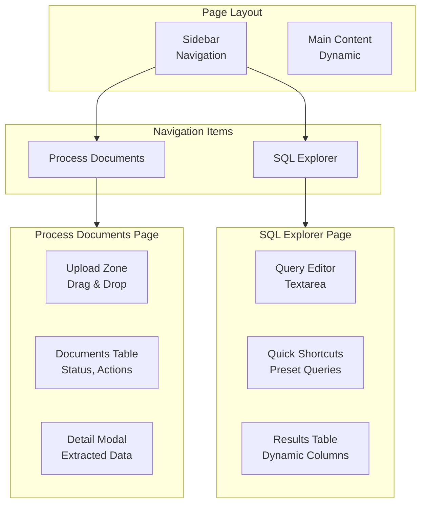

### UI Features

- **Light Theme**: Clean, professional design
- **Drag & Drop Upload**: Easy document upload
- **Real-time Status**: Auto-polling for processing updates
- **Modal View**: Detailed extraction results
- **SQL Explorer**: Direct database queries with preset shortcuts

---

## Technology Stack

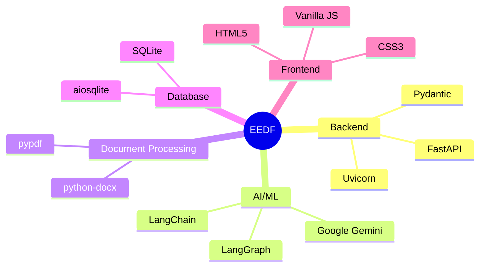

---

## Dependencies

| Package | Version | Purpose |
|---------|---------|---------|
| fastapi | >=0.115.0 | Web framework |
| uvicorn | >=0.32.0 | ASGI server |
| python-multipart | >=0.0.12 | File upload handling |
| pypdf | >=5.0.0 | PDF text extraction |
| python-docx | >=1.1.0 | DOCX text extraction |
| google-genai | >=1.0.0 | Gemini LLM API |
| langchain | >=0.3.0 | LLM orchestration |
| langgraph | >=0.2.0 | Agentic workflows |
| aiosqlite | >=0.20.0 | Async SQLite |
| pydantic | >=2.9.0 | Data validation |
| reportlab | >=4.2.0 | PDF generation (test docs) |

---

## Error Handling

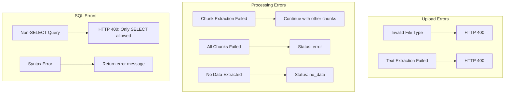

---

## License

MIT License

---

## Contributing

1. Fork the repository
2. Create a feature branch
3. Make your changes
4. Submit a pull request

---

## Support

For issues and feature requests, please open an issue on GitHub.
