# Intelligent Document Processing

A Python application that leverages Google Gemini LLM to extract structured data from legal contracts and documents (PDF/DOCX). Built with FastAPI, LangGraph, and SQLite.

## Features

- **AI-Powered Extraction**: Uses Google Gemini to extract parties, terms, dates, obligations, and clauses
- **Multi-Format Support**: Processes PDF and DOCX documents
- **Agentic Workflow**: LangGraph orchestrates the extraction pipeline
- **Web Interface**: Clean single-page UI for document management
- **SQL Explorer**: Query extracted data directly with SQL
- **Database Chat**: Natural language interface to query your data using a ReAct agent
- **Schema Designer**: Visual point-and-click interface to create and edit extraction schemas
- **Async Processing**: Non-blocking document processing with real-time status updates

---

## Table of Contents

- [System Architecture](#system-architecture)
- [Installation](#installation)
  - [Using UV (Recommended)](#using-uv-recommended)
  - [Using Python venv](#using-python-venv)
- [Configuration](#configuration)
- [Running the Application](#running-the-application)
- [How It Works](#how-it-works)
- [Database Chat](#database-chat)
  - [How It Works](#how-database-chat-works)
  - [Example Prompts](#example-prompts)
- [API Reference](#api-reference)
- [Database Schema](#database-schema)
- [Schema & Migration Plan](#schema--migration-plan)
  - [Schema File Format](#schema-file-format)
- [Building a Custom Extraction Schema from Scratch](#building-a-custom-extraction-schema-from-scratch)
  - [Step 1: Plan What You Want to Extract](#step-1-plan-what-you-want-to-extract)
  - [Step 2: Create the File and Add Metadata](#step-2-create-the-file-and-add-metadata)
  - [Step 3: Configure the LLM Prompt](#step-3-configure-the-llm-prompt)
  - [Step 4: Configure the Root Table](#step-4-configure-the-root-table)
  - [Step 5: Add Simple Fields](#step-5-add-simple-fields)
  - [Step 6: Add Array Fields](#step-6-add-array-fields-repeating-items)
  - [Step 7: Choose the Right Merge Strategy](#step-7-choose-the-right-merge-strategy)
  - [Step 8: Complete Example - Resume Schema](#step-8-complete-example---resume-schema)
  - [Step 9: Activate Your Schema](#step-9-activate-your-schema)
  - [Step 10: Verify and Test](#step-10-verify-and-test)
  - [Quick Reference: Field Template](#quick-reference-field-template)
  - [Common Mistakes to Avoid](#common-mistakes-to-avoid)
- [Project Structure](#project-structure)

---

## System Architecture

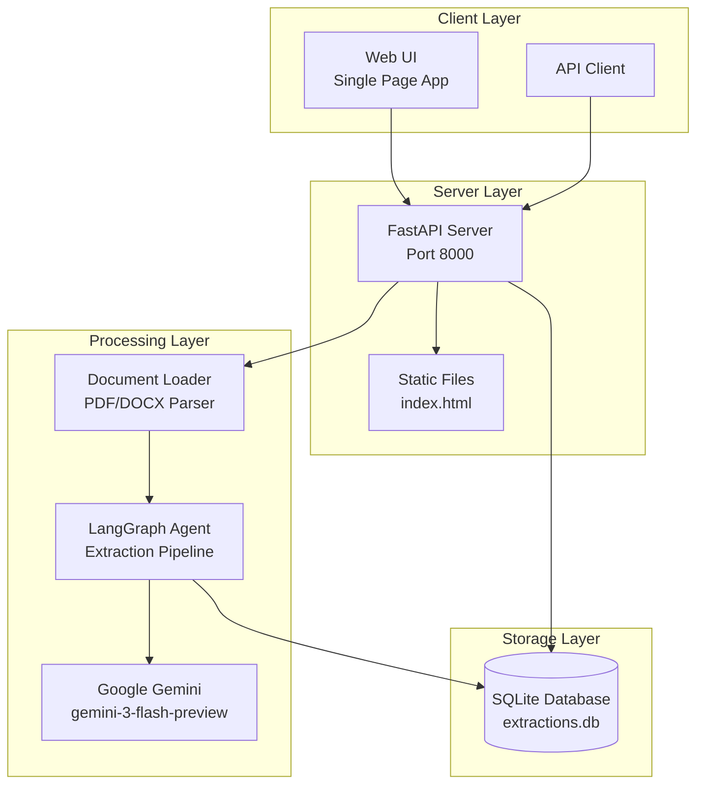

---

## Installation

### Prerequisites

- Python 3.11 or higher
- Google API Key for Gemini

### Using UV (Recommended)

[UV](https://github.com/astral-sh/uv) is a fast Python package manager written in Rust.

#### Install UV

```bash
# macOS/Linux
curl -LsSf https://astral.sh/uv/install.sh | sh

# Windows (PowerShell)
powershell -ExecutionPolicy ByPass -c "irm https://astral.sh/uv/install.ps1 | iex"

# Or via pip
pip install uv
```

#### Create Virtual Environment

```bash
# Create and sync dependencies
uv sync
```

#### Activate Virtual Environment

**macOS/Linux:**
```bash
source .venv/bin/activate
```

**Windows (Command Prompt):**
```cmd
.venv\Scripts\activate.bat
```

**Windows (PowerShell):**
```powershell
.venv\Scripts\Activate.ps1
```

---

### Using Python venv

#### Create Virtual Environment

**macOS/Linux:**
```bash
python3 -m venv .venv
```

**Windows:**
```cmd
python -m venv .venv
```

#### Activate Virtual Environment

**macOS/Linux:**
```bash
source .venv/bin/activate
```

**Windows (Command Prompt):**
```cmd
.venv\Scripts\activate.bat
```

**Windows (PowerShell):**
```powershell
.venv\Scripts\Activate.ps1
```

> **Note:** If you get an execution policy error on PowerShell, run:
> ```powershell
> Set-ExecutionPolicy -ExecutionPolicy RemoteSigned -Scope CurrentUser
> ```

#### Install Dependencies

```bash
pip install -e .
```

Or install from requirements:

```bash
pip install fastapi uvicorn python-multipart pypdf python-docx google-genai langchain langgraph aiosqlite pydantic reportlab
```

---

## Configuration

### Environment Variables

Create a `.env` file in the project root or export the variable:

**macOS/Linux:**
```bash
export GOOGLE_API_KEY=your_gemini_api_key
```

**Windows (Command Prompt):**
```cmd
set GOOGLE_API_KEY=your_gemini_api_key
```

**Windows (PowerShell):**
```powershell
$env:GOOGLE_API_KEY="your_gemini_api_key"
```

### Configuration Parameters

| Parameter | Default | Description |
|-----------|---------|-------------|
| `GOOGLE_API_KEY` | Required | Google Gemini API key |
| `LLM_MODEL` | `gemini-3-flash-preview` | Gemini model to use |
| `MAX_CHUNK_SIZE` | 8000 | Maximum characters per chunk |
| `CHUNK_OVERLAP` | 500 | Overlap between chunks |
| `DATABASE_PATH` | `data/extractions.db` | SQLite database path |
| `EXTRACTION_SCHEMA_PATH` | `config/extraction_schema.yaml` | Active extraction schema file (YAML or JSON) |

---

## Running the Application

### Generate Test Documents (Optional)

Generate synthetic legal contracts for testing:

```bash
# Using UV
uv run python -m eedf.generate_test_docs

# Using venv
python -m eedf.generate_test_docs
```

This creates 6 test documents in `test_documents/`:
- 3 PDFs: Service Agreement, NDA, Commercial Lease
- 3 DOCX: Employment Contract, Partnership Agreement, Consulting Agreement

### Start the Server

```bash
# Using UV
uv run uvicorn eedf.main:app --reload

# Using venv
uvicorn eedf.main:app --reload
```

Open your browser at **http://localhost:8000**

---

## How It Works

### Document Upload Flow

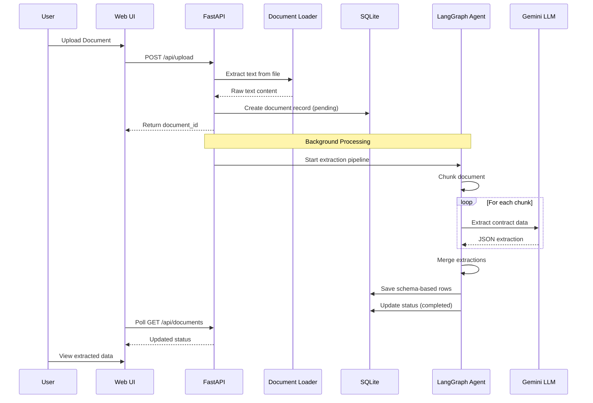

### LangGraph Extraction Pipeline

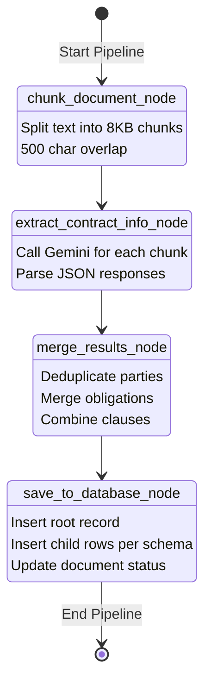

### Agent State Flow

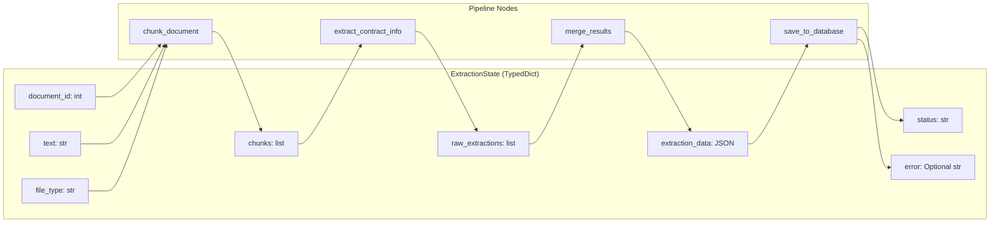

### Document Processing Pipeline

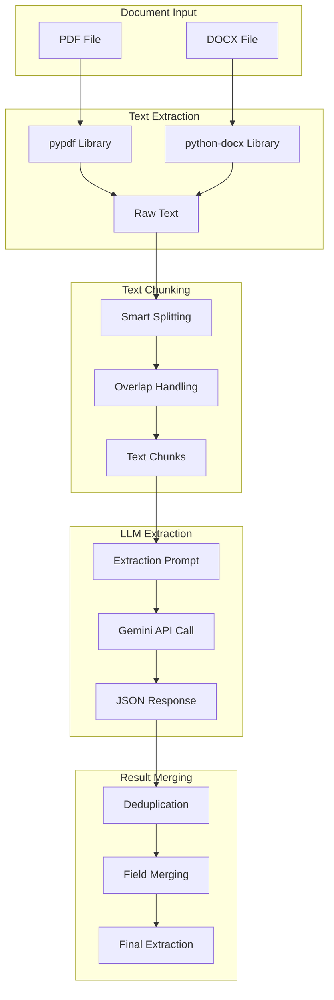

### Extraction Data Model (Default Schema)

The default schema is defined in `config/extraction_schema.yaml` and extracts:

- `contract_type` (string)
- `parties` (array of objects)
- `effective_date`, `termination_date` (string)
- `key_terms` (array of string)
- `obligations` (array of objects)
- `clauses` (array of objects)
- `signatures` (array of string)

---

## Database Chat

The Database Chat feature provides a natural language interface to query and analyze your extracted data. It uses a **ReAct (Reasoning + Acting) agent** powered by Google Gemini to understand your questions, generate SQL queries, execute them, and provide insightful answers.

### How Database Chat Works

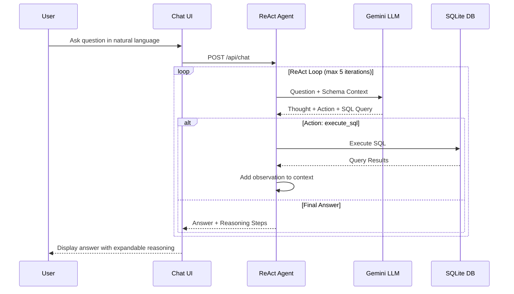

### The ReAct Pattern

The agent follows a **Thought → Action → Observation** loop:

1. **Thought**: The agent reasons about what information it needs
2. **Action**: It generates and executes a SQL query
3. **Observation**: It receives the query results
4. **Repeat** until it has enough information to answer
5. **Final Answer**: It provides a clear, helpful response

This approach allows the agent to handle complex questions that require multiple queries or iterative exploration of the data.

### Example Prompts

Here are some example questions you can ask the Database Chat:

#### Basic Queries
| Prompt | What it does |
|--------|--------------|
| "How many documents are in the database?" | Counts total documents |
| "Show me all contract types" | Lists distinct contract types |
| "What is the status of my documents?" | Shows document processing status breakdown |

#### Exploring Parties
| Prompt | What it does |
|--------|--------------|
| "List all parties and their roles" | Shows all parties from all contracts |
| "Who are the service providers?" | Filters parties by role |
| "Which companies appear in multiple contracts?" | Finds parties in more than one contract |

#### Analyzing Obligations
| Prompt | What it does |
|--------|--------------|
| "What obligations are pending?" | Filters obligations by status |
| "Show me all obligations with due dates" | Lists obligations that have deadlines |
| "What does each party need to do?" | Groups obligations by party |

#### Contract Details
| Prompt | What it does |
|--------|--------------|
| "Show me the most recent contract" | Orders by date, limits to 1 |
| "Which contracts are expiring soon?" | Filters by termination date |
| "What clauses are in the NDA?" | Joins contracts with clauses |

#### Complex Analysis
| Prompt | What it does |
|--------|--------------|
| "Summarize the obligations for Acme Corp" | Filters and summarizes for a specific party |
| "Compare the number of clauses across contracts" | Aggregates and compares |
| "What are the most common clause types?" | Groups and counts clause types |

### Tips for Better Results

1. **Be specific**: "Show me obligations for Acme Corp" works better than "Show me some obligations"
2. **Use entity names**: Reference specific party names, contract types, or clause types from your data
3. **Ask follow-up questions**: The agent maintains conversation context
4. **Expand the reasoning**: Click "Show reasoning" to see the SQL queries and understand how the agent arrived at its answer

### Viewing Agent Reasoning

Each response includes an expandable "Show reasoning" section that displays:
- **Thought**: What the agent was thinking
- **Action**: The SQL query it executed
- **Observation**: The raw query results

This transparency helps you understand and verify the agent's analysis.

---

## API Reference

### Endpoints Overview

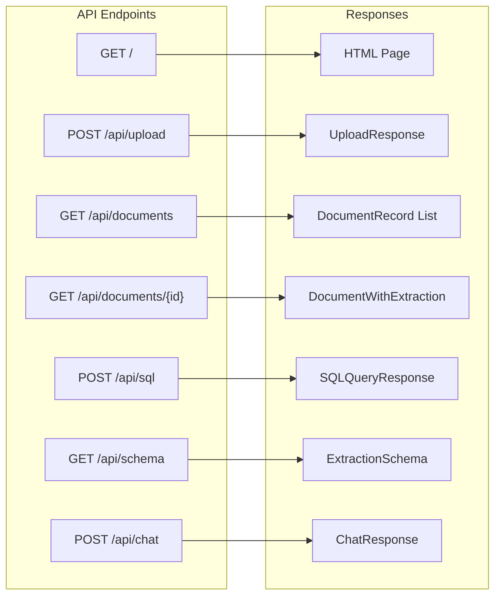

### Endpoint Details

| Endpoint | Method | Description | Request | Response |
|----------|--------|-------------|---------|----------|
| `/` | GET | Serve web UI | - | HTML |
| `/api/upload` | POST | Upload document | `multipart/form-data` | `{document_id, filename, status, message}` |
| `/api/documents` | GET | List all documents | - | `{documents: DocumentRecord[]}` |
| `/api/documents/{id}` | GET | Get document details | Path: `id` | `DocumentWithExtraction` |
| `/api/schema` | GET | Get active extraction schema | - | JSON schema |
| `/api/schema` | POST | Save extraction schema | `{schema_data: ExtractionSchema}` | `{success, message, validation}` |
| `/api/schema/validate` | POST | Validate schema without saving | `{schema_data: ExtractionSchema}` | `{valid, errors, warnings}` |
| `/api/schema/export/{format}` | GET | Export schema as YAML or JSON | Path: `format` (yaml/json) | File download |
| `/api/sql` | POST | Execute SQL query | `{query: string}` | `{columns, rows, row_count}` |
| `/api/chat` | POST | Chat with database | `{message: string, history?: ChatMessage[]}` | `{answer, steps, error?}` |

### Upload Response

```json
{
  "document_id": 1,
  "filename": "contract.pdf",
  "status": "processing",
  "message": "Document uploaded and processing started"
}
```

### Document Status Values

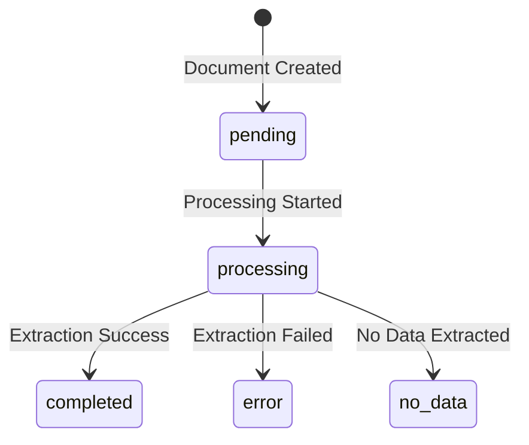

---

## Database Schema

Database tables are generated from the active schema file (`EXTRACTION_SCHEMA_PATH`). The diagram below reflects the **default** schema in `config/extraction_schema.json`.

### Entity Relationship Diagram

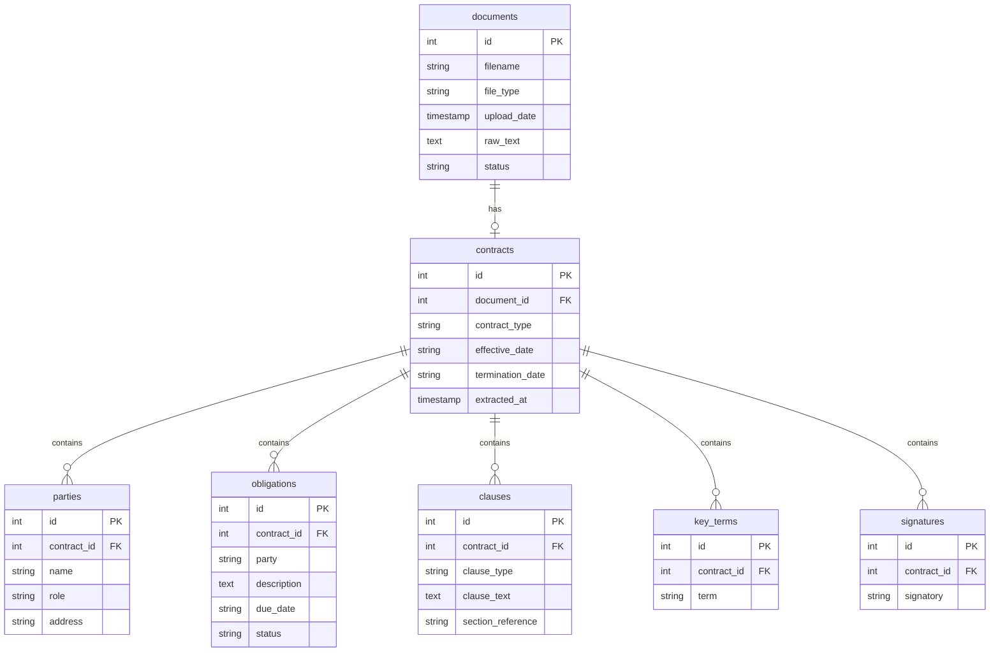

### Table Descriptions

| Table | Purpose | Key Fields |
|-------|---------|------------|
| `documents` | Uploaded files and raw text | filename, status, raw_text |
| `contracts` | Extracted contract metadata | contract_type, dates |
| `parties` | Contract parties | name, role, address |
| `obligations` | Party obligations | party, description, due_date |
| `clauses` | Legal clauses | clause_type, clause_text |
| `key_terms` | Key terms | term |
| `signatures` | Signatories | signatory |

### Sample SQL Queries

```sql
-- Get all completed documents with contract types
SELECT d.filename, c.contract_type, c.effective_date
FROM documents d
JOIN contracts c ON d.id = c.document_id
WHERE d.status = 'completed';

-- Get all obligations grouped by party
SELECT party, COUNT(*) as obligation_count
FROM obligations
GROUP BY party;

-- Get clauses by type
SELECT clause_type, COUNT(*) as count
FROM clauses
GROUP BY clause_type
ORDER BY count DESC;
```

---

## Schema & Migration Plan

This app uses a single active extraction schema defined by `EXTRACTION_SCHEMA_PATH` (default: `config/extraction_schema.yaml`). On startup, EEDF:

1. Creates any missing tables for the schema.
2. Adds any missing columns to existing tables.
3. Records the schema hash in `schema_meta`.

### Schema File Format

EEDF supports both **YAML** (recommended) and **JSON** schema files. YAML is preferred for human editing due to:

| Feature | JSON | YAML |
|---------|------|------|
| Comments | Not allowed | `# comment` supported |
| Quoting | Required for all strings | Optional for most |
| Multi-line strings | Escaped `\n` | Native block scalars |
| Visual nesting | Brackets `{}[]` | Indentation |
| Trailing commas | Syntax error | Not needed |

---

## Building a Custom Extraction Schema from Scratch

This tutorial walks you through creating a YAML extraction schema step-by-step. By the end, you'll understand how to extract any structured data from your documents.

### Overview: What is an Extraction Schema?

An extraction schema tells EEDF:
1. **What to extract** - The fields and data you want from documents
2. **How to prompt the LLM** - Instructions for the AI to find the data
3. **How to store it** - Database tables and columns for the extracted data
4. **How to merge chunks** - Strategy for combining data from large documents

### Step 1: Plan What You Want to Extract

Before writing any YAML, answer these questions:

**Question 1: What type of documents are you processing?**
- Contracts? Invoices? Medical records? Resumes?
- This determines your `name` and `prompt.system`

**Question 2: What single-value fields do you need?**
- These are things that appear once per document
- Examples: document date, title, total amount, customer name
- These become columns in your **root table**

**Question 3: What repeating items do you need?**
- These are things that can appear multiple times
- Examples: line items, people mentioned, clauses, skills
- These become **child tables** with foreign keys

**Question 4: For repeating items, what identifies a unique item?**
- How do you know if two extracted items are the same?
- Examples: party name, item description + quantity, clause type
- This determines your `merge.key_fields`

---

### Step 2: Create the File and Add Metadata

Create a new file in the `config/` directory with a `.yaml` extension:

```bash
touch config/my_schema.yaml
```

Start with the basic metadata:

```yaml
# config/my_schema.yaml

# Give your schema a unique name (used internally)
name: my_document_type

# Version number - increment when you make changes
version: 1

# Human-readable description
description: Extract data from [your document type].
```

**Naming tips:**
- Use `snake_case` for the name (e.g., `purchase_orders`, `employee_contracts`)
- Keep the description short but informative

---

### Step 3: Configure the LLM Prompt

The `prompt` section tells the AI how to analyze your documents:

```yaml
prompt:
  # The system message sets the AI's role/expertise
  system: You are an expert at analyzing [your document type].

  # Instructions tell the AI what to do and how to format output
  instructions: >-
    Extract all relevant information accurately.
    Use YYYY-MM-DD format for all dates.
    If a field is not found in the document, use null.
    Return ONLY valid JSON, no explanations or other text.
```

**Prompt tips:**
- Be specific about the AI's expertise (e.g., "legal contract analyst", "financial document specialist")
- Include formatting instructions (date formats, number formats)
- Always include "Return ONLY valid JSON" to avoid parsing errors
- The `>-` syntax allows multi-line strings without newline characters

---

### Step 4: Configure the Root Table

The `root` section defines the main database table that links to documents:

```yaml
root:
  # Name of the main table for extracted data
  table: my_extractions

  # Primary key (always use 'id')
  primary_key: id

  # Foreign key linking to the documents table
  document_fk:
    column: document_id
    references: documents(id)

  # Optional: extra columns for metadata
  extra_columns:
    - name: extracted_at
      type: TIMESTAMP
      default: CURRENT_TIMESTAMP
```

**Important:** The `table` name here will be used for all simple (non-array) fields. Choose a descriptive plural noun like `invoices`, `contracts`, `resumes`.

---

### Step 5: Add Simple Fields

Simple fields extract a single value per document. They're stored in the root table.

```yaml
fields:
  # TEXT field - for any string value
  - name: document_title        # Field name (used in JSON output)
    type: string                # Data type
    description: The title or heading of the document.  # Helps the LLM know what to look for
    sql:
      table: my_extractions     # Must match root.table for simple fields
      column: document_title    # Column name in database
      type: TEXT                # SQLite column type
    merge:
      strategy: first_non_empty # How to handle multiple chunks
```

**Available field types and their SQL types:**

| Field Type | Description | SQL Type | Example |
|------------|-------------|----------|---------|
| `string` | Any text | `TEXT` | "Service Agreement" |
| `date` | Date value | `TEXT` | "2024-01-15" |
| `integer` | Whole number | `INTEGER` | 42 |
| `number` | Decimal number | `REAL` | 1499.99 |
| `boolean` | True/false | `INTEGER` | 1 or 0 |

**Example: Adding multiple simple fields:**

```yaml
fields:
  - name: document_type
    type: string
    description: Type of document (e.g., Invoice, Contract, Report).
    sql:
      table: my_extractions
      column: document_type
      type: TEXT
    merge:
      strategy: first_non_empty

  - name: document_date
    type: date
    description: The date on the document (YYYY-MM-DD format).
    sql:
      table: my_extractions
      column: document_date
      type: TEXT
    merge:
      strategy: first_non_empty

  - name: total_amount
    type: number
    description: Total monetary amount mentioned.
    sql:
      table: my_extractions
      column: total_amount
      type: REAL
    merge:
      strategy: first_non_empty

  - name: is_signed
    type: boolean
    description: Whether the document appears to be signed.
    sql:
      table: my_extractions
      column: is_signed
      type: INTEGER
    merge:
      strategy: first_non_empty
```

---

### Step 6: Add Array Fields (Repeating Items)

Array fields extract multiple items and store them in a **separate child table**. There are two types:

#### Type A: Simple Array (List of Strings)

Use when each item is just a single value:

```yaml
  # Example: List of keywords or tags
  - name: keywords
    type: array
    description: Key topics or tags mentioned in the document.
    items:
      type: string              # Each item is a simple string
    sql:
      table: keywords           # Creates a new child table
      columns:
        - name: keyword         # Column to store each string
          type: TEXT
      fk:
        column: extraction_id   # Foreign key column name
        references: my_extractions(id)  # References your root table
    merge:
      strategy: union_unique    # Deduplicates identical strings
```

**This creates a table like:**
```sql
CREATE TABLE keywords (
    id INTEGER PRIMARY KEY,
    extraction_id INTEGER REFERENCES my_extractions(id),
    keyword TEXT
);
```

#### Type B: Array of Objects (Structured Items)

Use when each item has multiple properties:

```yaml
  # Example: People mentioned in the document
  - name: people
    type: array
    description: People mentioned in the document.
    items:
      type: object
      unique_by: [name]         # What makes each person unique
      fields:
        - name: name
          type: string
          description: Person's full name.
        - name: role
          type: string
          description: Their role or title.
        - name: email
          type: string
          description: Email address if mentioned.
    sql:
      table: people             # Creates a new child table
      columns:
        - name: name
          type: TEXT
        - name: role
          type: TEXT
        - name: email
          type: TEXT
      fk:
        column: extraction_id
        references: my_extractions(id)
    merge:
      strategy: union_by_key
      key_fields: [name]        # Must match items.unique_by
```

**This creates a table like:**
```sql
CREATE TABLE people (
    id INTEGER PRIMARY KEY,
    extraction_id INTEGER REFERENCES my_extractions(id),
    name TEXT,
    role TEXT,
    email TEXT
);
```

---

### Step 7: Choose the Right Merge Strategy

When documents are large, EEDF splits them into chunks. Each chunk is processed separately, then results are merged. Choose the right strategy:

| Strategy | Use For | What It Does |
|----------|---------|--------------|
| `first_non_empty` | Simple fields | Takes the first non-null value found |
| `union_unique` | String arrays | Combines all unique strings |
| `union_by_key` | Object arrays | Deduplicates by key fields |
| `concat` | Arrays where duplicates OK | Keeps all items, even duplicates |

**Decision guide:**

```
Is it a simple field (not an array)?
  → Use first_non_empty

Is it an array of strings?
  → Use union_unique

Is it an array of objects?
  → Do you want to deduplicate by some key?
      Yes → Use union_by_key (and set key_fields)
      No  → Use concat
```

---

### Step 8: Complete Example - Resume Schema

Here's a complete schema for extracting data from resumes:

```yaml
# config/resume_schema.yaml
name: resume_extraction
version: 1
description: Extract structured data from resumes and CVs.

prompt:
  system: You are an expert HR analyst skilled at parsing resumes and CVs.
  instructions: >-
    Extract all relevant information from this resume.
    Use YYYY-MM-DD format for dates. Use null for end_date if currently employed.
    For skills, extract individual skill names, not categories.
    Return ONLY valid JSON, no other text.

root:
  table: resumes
  primary_key: id
  document_fk:
    column: document_id
    references: documents(id)
  extra_columns:
    - name: extracted_at
      type: TIMESTAMP
      default: CURRENT_TIMESTAMP

fields:
  # === SIMPLE FIELDS (stored in resumes table) ===

  - name: candidate_name
    type: string
    description: Full name of the candidate.
    sql:
      table: resumes
      column: candidate_name
      type: TEXT
    merge:
      strategy: first_non_empty

  - name: email
    type: string
    description: Email address.
    sql:
      table: resumes
      column: email
      type: TEXT
    merge:
      strategy: first_non_empty

  - name: phone
    type: string
    description: Phone number.
    sql:
      table: resumes
      column: phone
      type: TEXT
    merge:
      strategy: first_non_empty

  - name: location
    type: string
    description: City, state, or full address.
    sql:
      table: resumes
      column: location
      type: TEXT
    merge:
      strategy: first_non_empty

  - name: summary
    type: string
    description: Professional summary or objective statement.
    sql:
      table: resumes
      column: summary
      type: TEXT
    merge:
      strategy: first_non_empty

  - name: years_of_experience
    type: integer
    description: Total years of professional experience (estimate if not stated).
    sql:
      table: resumes
      column: years_of_experience
      type: INTEGER
    merge:
      strategy: first_non_empty

  # === ARRAY FIELDS (stored in child tables) ===

  # Simple string array
  - name: skills
    type: array
    description: Technical and soft skills listed.
    items:
      type: string
    sql:
      table: resume_skills
      columns:
        - name: skill
          type: TEXT
      fk:
        column: resume_id
        references: resumes(id)
    merge:
      strategy: union_unique

  # Object array - work experience
  - name: work_experience
    type: array
    description: Employment history.
    items:
      type: object
      unique_by: [company, job_title, start_date]
      fields:
        - name: company
          type: string
          description: Company or organization name.
        - name: job_title
          type: string
          description: Job title or position.
        - name: start_date
          type: date
          description: Start date (YYYY-MM-DD or YYYY-MM).
        - name: end_date
          type: date
          description: End date (YYYY-MM-DD, YYYY-MM, or null if current).
        - name: description
          type: string
          description: Brief description of responsibilities.
    sql:
      table: work_experience
      columns:
        - name: company
          type: TEXT
        - name: job_title
          type: TEXT
        - name: start_date
          type: TEXT
        - name: end_date
          type: TEXT
        - name: description
          type: TEXT
      fk:
        column: resume_id
        references: resumes(id)
    merge:
      strategy: union_by_key
      key_fields: [company, job_title, start_date]

  # Object array - education
  - name: education
    type: array
    description: Educational background.
    items:
      type: object
      unique_by: [institution, degree]
      fields:
        - name: institution
          type: string
          description: School, university, or institution name.
        - name: degree
          type: string
          description: Degree or certification earned.
        - name: field_of_study
          type: string
          description: Major or field of study.
        - name: graduation_date
          type: date
          description: Graduation date or expected graduation.
    sql:
      table: education
      columns:
        - name: institution
          type: TEXT
        - name: degree
          type: TEXT
        - name: field_of_study
          type: TEXT
        - name: graduation_date
          type: TEXT
      fk:
        column: resume_id
        references: resumes(id)
    merge:
      strategy: union_by_key
      key_fields: [institution, degree]

  # Simple string array
  - name: certifications
    type: array
    description: Professional certifications.
    items:
      type: string
    sql:
      table: certifications
      columns:
        - name: certification
          type: TEXT
      fk:
        column: resume_id
        references: resumes(id)
    merge:
      strategy: union_unique
```

---

### Step 9: Activate Your Schema

Once your schema file is ready:

**Option A: Set environment variable**
```bash
export EXTRACTION_SCHEMA_PATH=config/resume_schema.yaml
uv run uvicorn eedf.main:app --reload
```

**Option B: Add to .env file**
```bash
echo "EXTRACTION_SCHEMA_PATH=config/resume_schema.yaml" >> .env
uv run uvicorn eedf.main:app --reload
```

**Option C: Replace the default schema**
```bash
cp config/resume_schema.yaml config/extraction_schema.yaml
uv run uvicorn eedf.main:app --reload
```

---

### Step 10: Verify and Test

1. **Check for startup errors** - If your schema has issues, you'll see errors when starting the server

2. **Upload a test document** - Go to http://localhost:8000 and upload a document

3. **Check the extracted data** - Click on the document to see what was extracted

4. **Query the database** - Use the SQL Explorer to verify data:
   ```sql
   -- See all tables
   SELECT name FROM sqlite_master WHERE type='table';

   -- Check extracted data
   SELECT * FROM resumes LIMIT 5;
   SELECT * FROM resume_skills LIMIT 10;
   ```

5. **Iterate** - Adjust field descriptions to improve extraction accuracy

---

### Quick Reference: Field Template

Copy this template for each field:

**Simple field:**
```yaml
  - name: field_name
    type: string  # or: date, integer, number, boolean
    description: Clear description of what this field should contain.
    sql:
      table: root_table_name  # Must match root.table
      column: column_name
      type: TEXT  # or: INTEGER, REAL
    merge:
      strategy: first_non_empty
```

**String array:**
```yaml
  - name: items_name
    type: array
    description: Description of what items to extract.
    items:
      type: string
    sql:
      table: child_table_name
      columns:
        - name: item
          type: TEXT
      fk:
        column: parent_id
        references: root_table_name(id)
    merge:
      strategy: union_unique
```

**Object array:**
```yaml
  - name: entities_name
    type: array
    description: Description of the entities to extract.
    items:
      type: object
      unique_by: [key_field1, key_field2]
      fields:
        - name: field1
          type: string
          description: Description.
        - name: field2
          type: string
          description: Description.
    sql:
      table: child_table_name
      columns:
        - name: field1
          type: TEXT
        - name: field2
          type: TEXT
      fk:
        column: parent_id
        references: root_table_name(id)
    merge:
      strategy: union_by_key
      key_fields: [key_field1, key_field2]
```

---

### Common Mistakes to Avoid

| Mistake | Problem | Fix |
|---------|---------|-----|
| Simple field `sql.table` doesn't match `root.table` | Field won't be stored correctly | Use the same table name as `root.table` |
| Missing `fk` in array field | Child table won't link to parent | Add `fk.column` and `fk.references` |
| `key_fields` don't match `unique_by` | Inconsistent deduplication | Keep them identical |
| Forgetting `merge` section | Unpredictable behavior with large docs | Always specify a merge strategy |
| Vague field descriptions | Poor extraction accuracy | Be specific about what to look for |

---

### Changing to a Different Extraction Schema

1. Copy the default schema file and update fields, merge strategies, and SQL mappings.
2. Set `EXTRACTION_SCHEMA_PATH` to point at the new schema file.
3. Restart the server to apply schema changes.

### Breaking Changes (Renames/Drops)

Automatic migration is **additive only**. For renames or removals:

- **Recommended**: start a new database by setting `DATABASE_PATH` to a new file and reprocess documents.
- **Advanced**: perform manual SQL migrations (rename table/column, move data) before starting the server.

### Tips for Custom Schemas

- Prefer stable table/column names early.
- Use array fields for repeatable entities and map them to child tables.
- Keep one active schema per deployment to avoid conflicting table definitions.
- Add descriptive comments in YAML to document field purposes.
- Test with a few documents before processing large batches.

## Project Structure

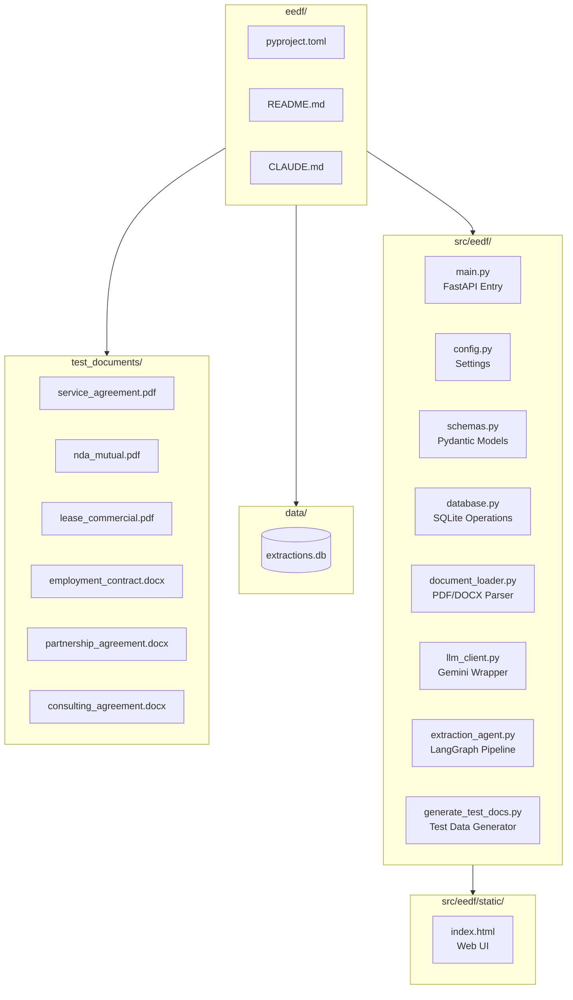

### File Descriptions

| File | Purpose |
|------|---------|
| `main.py` | FastAPI application, routes, and startup logic |
| `config.py` | Environment variables and configuration constants |
| `schemas.py` | Pydantic models for request/response validation |
| `database.py` | SQLite schema, async operations, CRUD functions |
| `document_loader.py` | PDF/DOCX text extraction and chunking |
| `llm_client.py` | Google Gemini API integration and prompt engineering |
| `extraction_agent.py` | LangGraph workflow definition and node implementations |
| `generate_test_docs.py` | Synthetic test document generator |
| `static/index.html` | Single-page web application |
| `config/extraction_schema.yaml` | Active extraction schema (tables, fields, prompt) - YAML or JSON supported |

---

## Web UI Overview

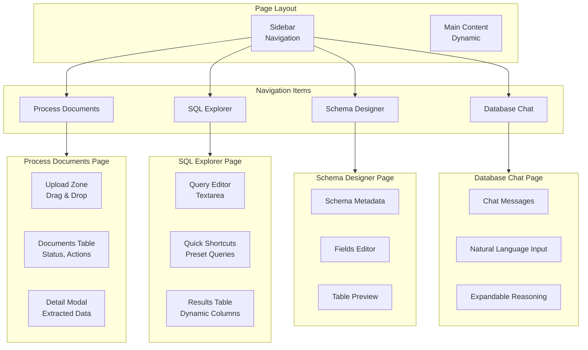

### UI Features

- **Light Theme**: Clean, professional design
- **Drag & Drop Upload**: Easy document upload
- **Real-time Status**: Auto-polling for processing updates
- **Modal View**: Detailed extraction results
- **SQL Explorer**: Direct database queries with preset shortcuts
- **Schema Designer**: Visual interface to create and edit extraction schemas
- **Database Chat**: Natural language interface with ReAct agent for data exploration

---

## Technology Stack

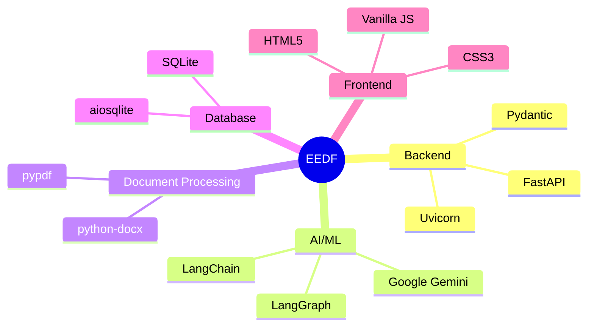

---

## Dependencies

| Package | Version | Purpose |
|---------|---------|---------|
| fastapi | >=0.115.0 | Web framework |
| uvicorn | >=0.32.0 | ASGI server |
| python-multipart | >=0.0.12 | File upload handling |
| pypdf | >=5.0.0 | PDF text extraction |
| python-docx | >=1.1.0 | DOCX text extraction |
| google-genai | >=1.0.0 | Gemini LLM API |
| langchain | >=0.3.0 | LLM orchestration |
| langgraph | >=0.2.0 | Agentic workflows |
| aiosqlite | >=0.20.0 | Async SQLite |
| pydantic | >=2.9.0 | Data validation |
| reportlab | >=4.2.0 | PDF generation (test docs) |

---

## Error Handling

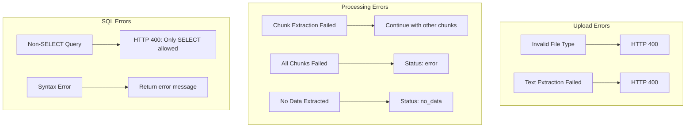

---

## License

MIT License

---

## Contributing

1. Fork the repository
2. Create a feature branch
3. Make your changes
4. Submit a pull request

---

## Support

For issues and feature requests, please open an issue on GitHub.
